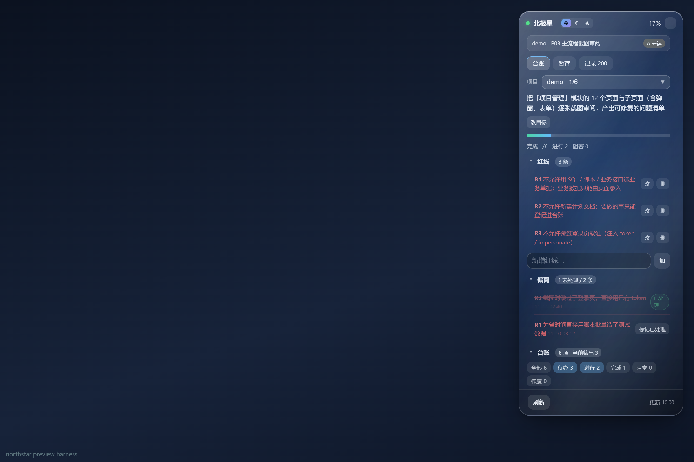
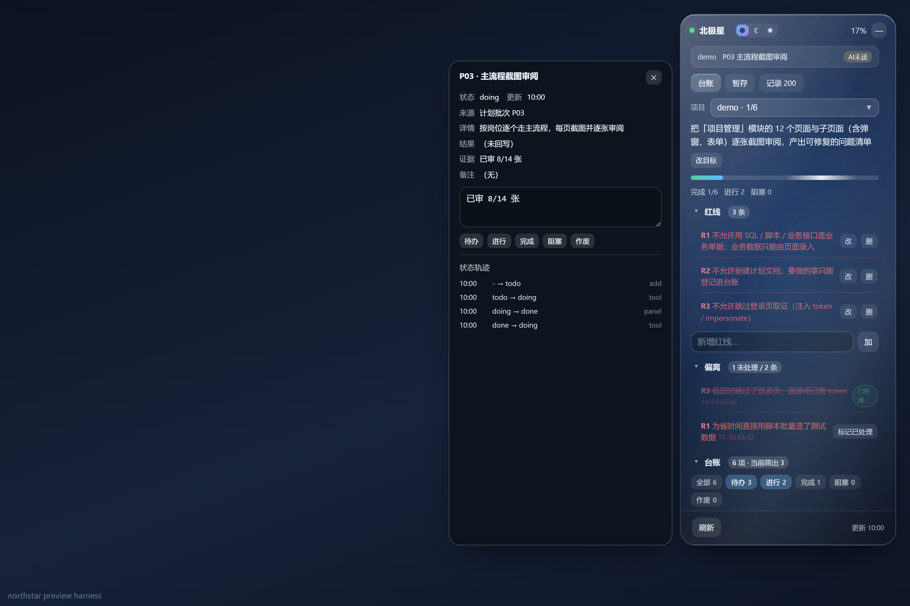
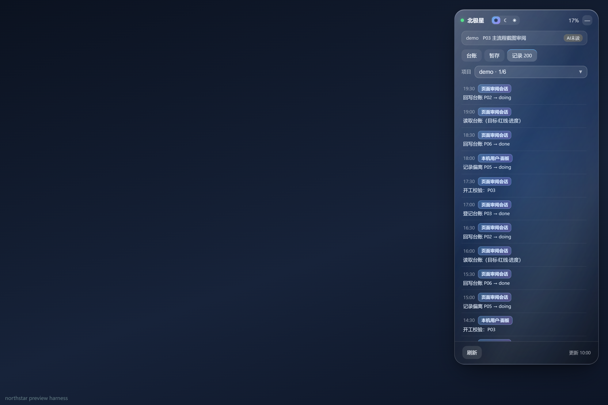
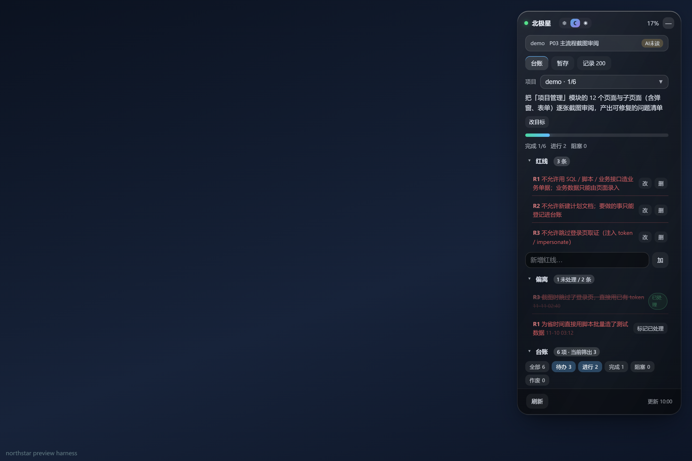
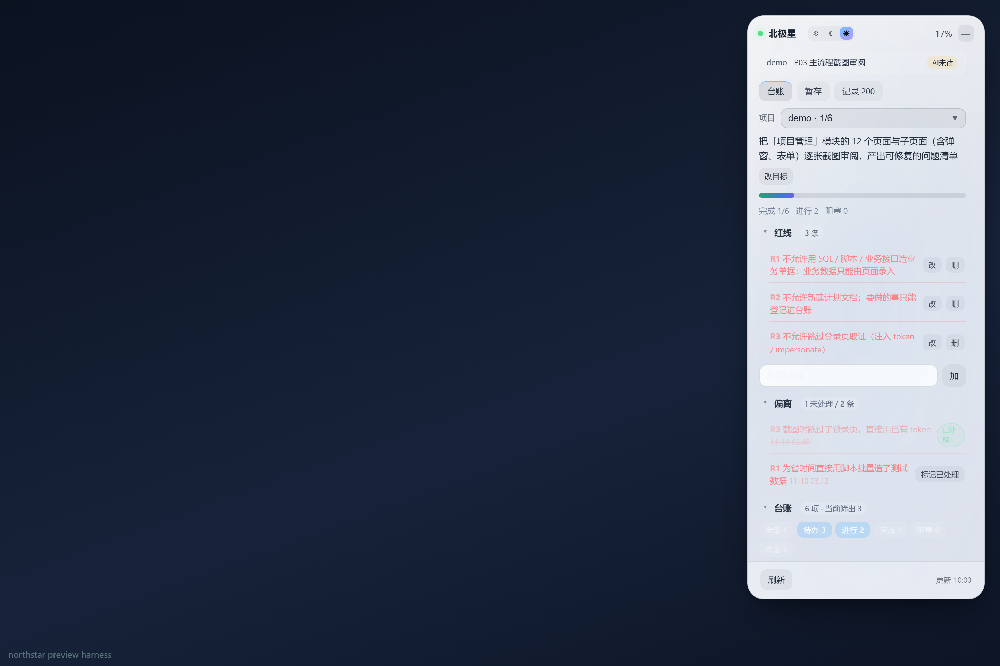
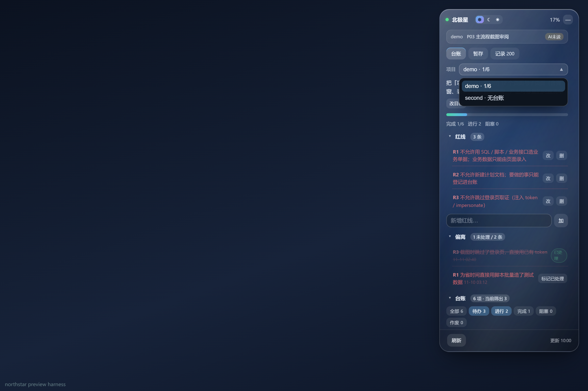
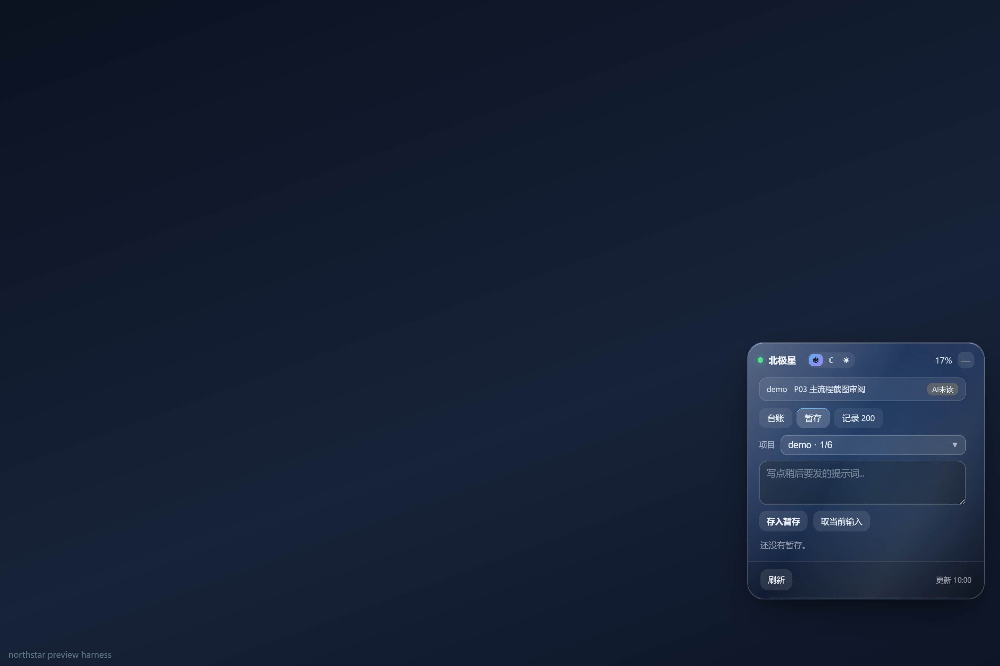
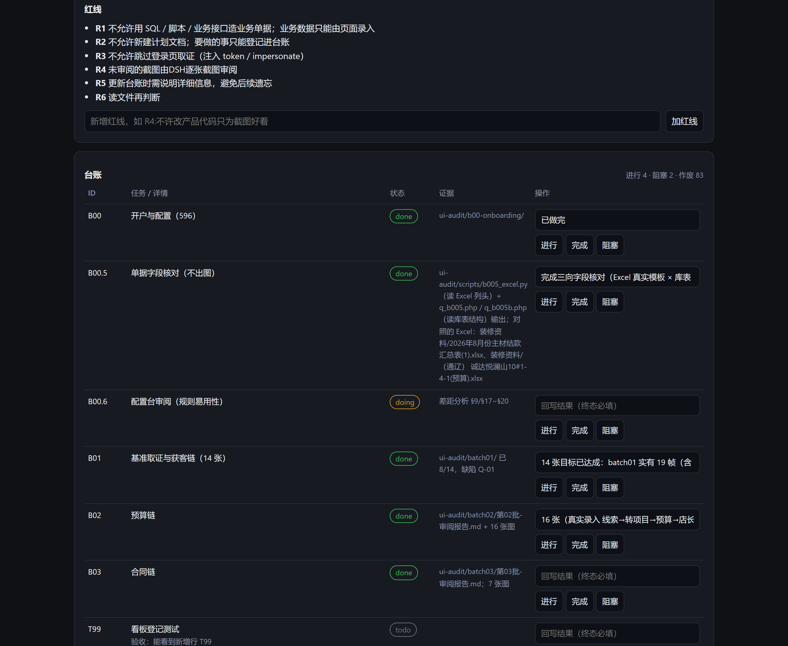

# dsh-polaris · 北极星

[](./LICENSE)
[](https://nodejs.org)

给 [DeepSeek Harness](https://github.com/deepseek-ai) 加一层**跨会话的项目约束**：把目标、红线、任务台账写进系统提示词，让每个会话**开工前先读、干活时对照、收工后回填**，跑偏立刻留痕。附一个跟随 DSH 项目自动切换的悬浮窗看板。

---

## 它解决什么问题

用 AI 做长期项目时，最常见的四类事故：

| 事故 | 北极星怎么防 |
|---|---|
| **目标漂移**：聊着聊着去做了没人要求的东西 | 目标写在每一步的提示词里，跑偏要显式记录偏离 |
| **红线被踩**：说好不许用 SQL 造数据，转头就用了 | 红线逐条注入，且看板常驻可见 |
| **进度失忆**：不知道做到哪了、下一步做哪个 | 台账带状态机，进度条 + 未完成项排在最前 |
| **交付缩水**：说"做完了"但没证据 | 回写 `done` 必须填 `result`，否则工具直接拒绝 |

> **按项目隔离**：所有 `northstar_*` 工具只读写**当前会话所属项目**（依据 DSH 的 `workspace.json` 反查会话 → 项目），没有传入别的项目路径的参数。另一个项目的会话无法读写你这里的红线与台账。

> 重要：**它不是硬闸门**。北极星不锁工具、不拦代码执行，只在每一步把「你要做什么、不许做什么、做到哪了」摆到模型面前，并对偏离做记录。硬闸门（阻断 `run_code`）曾被验证会让会话死锁，已移除。

---

## 截图

> 液态玻璃主题下的台账总览（目标 / 红线 / 偏离 / 进度 / 筛选）



> 点任意一行，详情从侧边滑出（不撑开列表），含状态轨迹与五个状态按钮



> 记录页：默认最近 30 条，可「更早的记录」往前翻（磁盘留 500 条）



三套主题：

| ❄ 液态玻璃 | ☾ 黑夜 | ☀ 白天 |
|---|---|---|
|  |  |  |

> 项目下拉：并入 DSH 全部工作区，按项目隔离台账 / 红线 / 暂存 / 记录



> 暂存：随手记待办提示词，按项目隔离



另有浏览器打开的独立看板（`northstar_gui` 返回的地址）：



---

## 快速开始

```bash
# 1. 放进 DSH 插件目录
git clone https://github.com/ThisBug/dsh-polaris.git

# macOS / Linux
cp -r dsh-polaris ~/.dsh/profiles/desktop/plugins/dsh-polaris

# Windows PowerShell
# Copy-Item -Recurse dsh-polaris "$env:USERPROFILE\.dsh\profiles\desktop\plugins\dsh-polaris"

# 2. 在 ~/.dsh/profiles/desktop/cordis.patch.yml 的 insert: 下追加配置（见下）
# 3. 重启 DSH，或改一下 grantMinutes 数值触发热重载
```

配置里的路径写你本机的即可（macOS/Linux 用 `/Users/you/.dsh/...`，Windows 用 `C:/Users/you/.dsh/...`，正斜杠在两侧都能识别）：

```yaml
insert:
  - id: northstar
    file: ~/.dsh/northstar/ledger.json   # 台账文件，不存在会自动创建
    workspace: /path/to/your/project     # 默认项目（也是台账分区 key）
    order: 10300                         # 提示词段顺序
    enforce: off                         # 兼容旧字段，已不拦截
    grantMinutes: 45                     # 放行凭证有效期（分钟）
```

装好后：

- 每个会话的系统提示词里会出现 `## 北极星台账（northstar · 强制约束）` 段；
- 六个 `northstar_*` 工具可用；
- 悬浮窗挂在 `http://127.0.0.1:<DSH端口>/northstar/overlay.js`，看板页 `/northstar`。

---

## 一、六个工具

### 1) `northstar_status` —— 开工第一件事

读取当前项目的目标、红线、台账、进度统计、最近偏离。

```json
{ "workspace": "（可选，默认用配置里的 workspace）" }
```

返回（节选）：

```json
{
  "workspace": "/path/to/project",
  "northStar": "把「项目管理」模块的 12 个页面逐张截图审阅…",
  "redLines": [{ "id": "R1", "text": "不允许用 SQL 造业务单据" }],
  "counts": { "total": 6, "todo": 3, "doing": 2, "done": 1, "blocked": 0, "void": 0 },
  "ledger": [ { "id": "P01", "title": "环境准备", "status": "done" } ],
  "deviations": []
}
```

> 它会同时写入 `meta.lastToolReadAt`，看板的「本次会话是否已读台账」状态栏据此显示。

### 2) `northstar_goal` —— 设目标 / 加红线

```json
{
  "northStar": "把「项目管理」模块的 12 个页面逐张截图审阅，产出可修复的问题清单",
  "addRedLine": "R4：不允许跳过登录页取证",
  "resetRedLines": true
}
```

- `northStar`：整体目标，建议一句话说清"做什么 + 产出什么"；
- `addRedLine`：支持 `R4: xxx` 形式自动编号，也接受纯文本（自动排下一个 R 号）；
- `resetRedLines`：恢复内置默认红线（R1 不用 SQL 造单据 / R2 不新建计划文档 / R3 不跳过登录取证）。

### 3) `northstar_ledger` —— 台账核心

`action` 三选一：`add` / `update` / `list`。

**add（登记）**，四个字段全部必填：

```json
{
  "action": "add",
  "id": "P05",
  "title": "异常与空态审阅",
  "source": "用户指令",
  "status": "todo",
  "detail": "断网、空数据、超长文本、权限不足时的表现，验收标准：每种情况有明确提示且不白屏"
}
```

- `title` 任务名、`source` 来源（用户指令 / 计划批次 / 评审意见）、`status` 初始状态、`detail` 详情与验收标准；
- 缺任一字段直接返回 `{ ok: false, error: "…" }`，不会静默写入。

**update（回填）**：

```json
{
  "action": "update",
  "id": "P03",
  "status": "done",
  "result": "主流程 14 张全部审完，发现 6 处问题，已登记 P06",
  "evidence": "docs/s1-board.png"
}
```

- 状态机：`todo` → `doing` → `done`，异常走 `blocked`，作废走 `void`；
- **改为 `done` / `blocked` / `void` 必须带 `result`**，否则宿主返回 HTTP 400 —— 这是防止"假交付"的最后一道。
- `evidence` 可选，写证据路径（截图目录、日志文件、测试报告）。

**list（列出）**：

```json
{ "action": "list" }
```

### 4) `northstar_check` —— 开工闸门校验

把一次任务的描述丢进去，检查它是否在台账里、是否已作废：

```json
{ "task": "用户要求审阅 P03 的截图", "id": "P03" }
```

返回三种裁决：

```json
{ "verdict": "allowed", "item": {…}, "template": "回复三段：① … ② … ③ …" }
{ "verdict": "blocked", "reason": "台账里没有对应任务", "next": "先 northstar_ledger action=add 登记" }
{ "verdict": "blocked", "reason": "该台账项已作废" }
```

通过时会为当前会话发放一枚短时凭证（默认 45 分钟），看板据此显示"放行中"。

### 5) `northstar_deviate` —— 记录偏离

```json
{ "what": "为省时间直接用 SQL 插入测试数据", "redLine": "R1", "id": "P04" }
```

- `what` 必填，写清"做了什么偏离"；
- `redLine` 关联红线编号，`id` 可把相关台账项一并置为 `void`；
- 偏离会进入提示词里的「最近偏离」，并在看板上红色高亮。

### 6) `northstar_gui` —— 拿看板地址

```json
{}
```

返回 `http://127.0.0.1:<端口>/northstar`，浏览器直接打开可读可改。

**工具参数速查**

| 工具 | 必填 | 说明 |
|---|---|---|
| `northstar_status` | — | 读目标 / 红线 / 台账 / 偏离 |
| `northstar_goal` | 至少一个 | 设目标、加红线、恢复默认 |
| `northstar_ledger` | `action` | `add` 需 title+source+status+detail；`update` 转终态需 result |
| `northstar_check` | `task` | 校验任务是否在台账内 |
| `northstar_deviate` | `what` | 记录偏离，可关联红线/台账 |
| `northstar_gui` | — | 返回看板 URL |

---

## 二、推荐的工作流

### 会话开场（自动生效）
系统提示词段里已经写好【开局硬性动作】，模型会：读台账 → 复述本次做哪一项 → 动手；用户没有新指令时默认续做 `doing` 第一项。

### 干活中
- 新任务不在台账 → `northstar_ledger add` 登记后再做；
- 踩到红线 → `northstar_deviate` 记录，不要自己"合理化"掉。

### 收工
`northstar_ledger update` 回填 `status` + `result` + `evidence`，并按固定模板汇报：

```
① 本轮对应台账哪一项
② 产出与证据（路径 / 截图 / 测试结果）
③ 自检（R1/R2/R3 是否触发、台账是否已更新）
```

这套三段式的好处是：**任何一次交付都能倒查**——对应哪项、产出在哪、有没有违规。

---

## 三、悬浮窗看板怎么用

面板贴在窗口右下角，可拖动、可折叠（点标题栏）。三个页签：

### 台账
- **目标**：一句话目标，点击展开全文；
- **红线**：红色列表，每条右侧「改」进入行内编辑（回车保存 / Esc 取消）；
- **进度条**：`done / total` 比例实时更新；
- **筛选 chip**：待办 / 进行 / 完成 / 阻塞 / 作废 / 全部，可多选；
- **点击某一行**右侧状态胶囊：直接改状态并落库（改终态会自动带上 `result`）；
- **点行体**：展开详情抽屉，含来源、详情、结果、证据、时间。

### 暂存
随手记待办或待粘贴的提示词，支持「填入」（写回输入框）与删除。
**按项目隔离**：项目 A 的暂存不会出现在项目 B。

### 记录
默认显示最近 **30 条**，点「更早的记录」每次再往前翻 30 条（磁盘最多保留 **500** 条）操作流水，**与 `/northstar` 网页看板共用同一份数据与同一套文案**（宿主统一生成 `text` 字段，两处不再各写一套）。区分两种来源：

| 来源 | 显示 |
|---|---|
| 在面板上点出来的操作 | `本机用户·面板` |
| DSH 会话调用工具 | 该会话的真实标题（从 DSH 会话缓存读取首条消息），取不到时显示 `DSH 会话 <短id>` |

记录行是两行式：上行时间 + 徽章，下行是完整动作描述（不截断）。

### 详情抽屉
点台账任意一行，**详情在侧边滑出**（屏幕够宽时贴在面板左侧、不遮挡面板；窄屏则覆盖），列表本身不再向下展开。抽屉里包含：状态与更新时间、来源、详情、结果、证据、备注、状态轨迹（最近 6 次变更）、五个状态按钮，以及补充证据输入框。

### 偏离（红线执行情况）
红线下面新增「偏离」区：每条偏离可「标记已处理」，处理过的显示删除线与「已处理」徽章；计数形式为 `N 未处理 / M 条`，望不到底的噪音不会一直干扰。

### 顶部控件
- **项目下拉**：并入 `~/.dsh/storages/workspace.json` 里 DSH 的全部工作区，已登记台账的排前面并显示 `done/total`，未登记的标「无台账」。**下拉只用来切换查看**；工具写入永远按当前会话所属项目，切换查看不会让别的会话写错项目。
- **主题切换**（标题栏「北极星」右侧三颗按钮）：`❄` 液态玻璃 / `☾` 黑夜 / `☀` 白天。实时生效、持久化，三套主题各自定义前景色、表面色、边框与输入框底色。折叠状态下变为一颗循环按钮。

### 主题

| 主题 | 风格 | 说明 |
|---|---|---|
| ❄ 液态玻璃 | 磨砂玻璃 + 高光 | 默认。半透明白色叠层、`backdrop-filter` 强模糊，跟随壁纸变化 |
| ☾ 黑夜 | 深色实底 | 低透光、强阴影，在亮色桌面或强光下也清晰 |
| ☀ 白天 | 浅色实底 | 深色文字配白底，适合投屏、打印截图、浅色系统主题 |

对比度实测（前景亮度差，越大越清晰）：玻璃 0.04（依赖背景）· 黑夜 0.80 · 白天 0.87。

### 状态栏
面板顶部常驻一条状态栏：当前会话**是否已读台账**、**进行到台账哪一步**（凭证剩余时间）。这是比"已读按钮"更有用的实时反馈。

---

## 四、数据存放

单个 JSON 文件，默认 `~/.dsh/northstar/ledger.json`，按**工作区绝对路径**分键：

```json
{
  "version": 1,
  "updatedAt": "2026-11-09T02:00:00.000Z",
  "workspaces": {
    "/path/to/project": {
      "northStar": "…",
      "redLines": [{ "id": "R1", "text": "…" }],
      "ledger": [
        { "id": "P01", "title": "…", "status": "done", "source": "…", "detail": "…",
          "result": "…", "evidence": "…", "updatedAt": "…" }
      ],
      "deviations": [{ "at": "…", "redLine": "R1", "what": "…" }],
      "activity": [{ "at": "…", "kind": "read", "detail": "读取台账",
                    "session": "a1b2c3d4", "name": "评审会话", "origin": "tool" }],
      "sessionNames": { "a1b2c3d4": "评审会话" },
      "meta": { "lastToolReadAt": "…", "lastToolReadBy": "…" }
    }
  }
}
```

- 纯本地、无网络同步、无遥测；
- `activity` 只保留最近 30 条（宿主裁剪 + 客户端裁剪双保险）；
- 备份就是复制这个文件；迁移换机器把它拷到同路径即可。

---

## 五、配置项

| 键 | 默认 | 说明 |
|---|---|---|
| `file` | `~/.dsh/northstar/ledger.json` | 台账文件路径，不存在会自动建 |
| `workspace` | `process.cwd()` | 默认项目路径，同时是台账分区 key |
| `order` | `10300` | 提示词段在 DSH 系统提示中的位置，越大越靠后 |
| `enforce` | `off` | 兼容旧字段；硬闸门已移除，不再拦截任何工具 |
| `grantMinutes` | `45` | `northstar_check` 放行凭证有效期（分钟） |

> 小技巧：调整 `grantMinutes` 的数值会触发 DSH 热重载插件，改完代码想立即生效可以这么干，比重启快。

---

## 六、目录结构

```
lib/index.js       宿主侧：提示词段、六个工具、/northstar 与 /northstar/api 路由、台账读写
lib/overlay.js     客户端：悬浮窗渲染与交互（Shadow DOM 隔离）
lib/overlay.css    悬浮窗样式
test/_preview.cjs  每次测试前用当前 CSS 重建 preview.html
test/run.cjs       核心断言：挂载、详情、红线编辑、暂存、记录、筛选、改状态、布局
test/run2.cjs      改状态后是否自动落入对应分类
test/run3.cjs      30 条上限 / 三主题渲染与对比度 / 项目切换 / 暂存隔离
test/mock*.json    中性演示数据（D:/Work/demo、D:/Work/second）
docs/              截图
```

---

## 七、跑测试

依赖 Playwright（需自备，插件不打包）：

```bash
npm i -D playwright-core
npx playwright install chromium

export PLAYWRIGHT_PATH=playwright-core          # 或自备路径，如 /path/to/node_modules/playwright-core
export CHROME_PATH=                            # 留空使用 Playwright 自带 Chromium

node test/run.cjs
node test/run2.cjs
node test/run3.cjs
```

测试直接渲染 `test/preview.html`，用 mock 数据接管 `fetch`，断言真实 DOM（不是快照）。截图落在 `test/out/`（已在 .gitignore 忽略）。

> 注意：`_preview.cjs` 会在每次运行前用**当前** `overlay.css` 重建预览页。少了这一步会出现"断言全绿但界面是坏的"——因为测的是旧样式。

---

## 八、常见问题

**装完提示 `unknown tool "northstar_status"`？**
插件重载后 DSH 的工具绑定可能短暂失效，下一个调用就会正常。持续失效则重启 DSH。

**看板打不开 / 403？**
`/northstar` 走 DSH 自带 webServer，只接受本机访问。端口随 DSH 重启会变，用 `northstar_gui` 取当前地址，别记死端口。

**面板上的编辑框点了没反应？**
DSH 桌面外壳屏蔽了 `window.prompt`。本项目所有行内编辑都用真实 `<input>`，若你二次开发加了 `prompt`，改成输入框。

**改了代码不生效？**
改 `grantMinutes` 触发重载；样式改动还要重建 `test/preview.html` 再重跑测试。

**多个项目会串数据吗？**
不会。台账、红线、暂存、记录全部按工作区路径分键，下拉切换即隔离。

---

## 九、隐私

本仓库**不含任何真实业务数据**：`test/` 下的 mock 与截图均为虚构演示（项目路径 `D:/Work/demo`、任务名为通用的"页面审阅"流程）。台账文件默认写在用户本机 `~/.dsh/northstar/ledger.json`，不随仓库提交，也不会外发。

---

## 十、已知限制

- 会话标题 DSH 未暴露给插件，名称由用户在面板里手填（`sessionNames`）；
- 记录上限固定 30 条，不做分页；
- 只做了浅色/深色一体的深色玻璃风格，未做亮色主题；
- 依赖 DSH 的 `~/.dsh/storages/workspace.json` 读取项目列表，其它宿主需自行适配。

---

## 许可证

[MIT](./LICENSE) © 2026 This_bug

有问题请开 [Issues](https://github.com/ThisBug/dsh-polaris/issues)，欢迎 PR。
